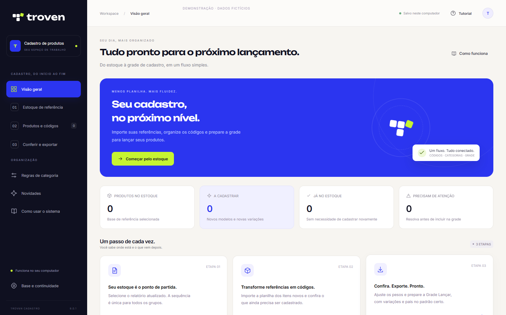
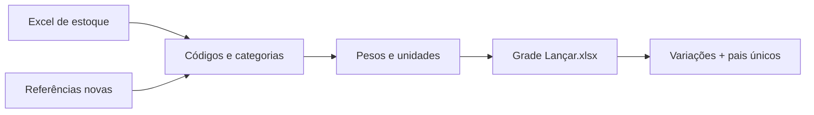

<p align="center">
  <picture>
    <source media="(prefers-color-scheme: dark)" srcset="app/assets/troven-horizontal-negativo.svg">
    
  </picture>
</p>

<h1 align="center">Seu cadastro, mais fluido.</h1>

<p align="center">Do Excel de estoque à Grade Lançar.<br>Uma interface clara para organizar referências, códigos, categorias e unidades.</p>

<p align="center">
  <a href="https://github.com/TrovenDev/greta-criar-codigos/releases/latest"></a>
  <a href="https://github.com/TrovenDev/greta-criar-codigos/releases/download/v9.0.1/Troven-Cadastro-Demonstracao.mp4"></a>
</p>

<p align="center">
  
  
  
  
</p>



## Veja o sistema em ação

O vídeo está **dentro do aplicativo**: abra **Vídeo de demonstração** no menu lateral ou no tutorial. Ele é instalado junto com o programa e funciona sem internet, com controles de pausa, velocidade e tela cheia.

A gravação usa o próprio aplicativo, dados fictícios e legendas em português. Você acompanha a importação, os filtros, a aplicação de categoria, a prévia da grade, a exportação e o changelog. As transições GSAP e as animações Lottie fazem parte da interface real.

**[▶ Assistir ou baixar o vídeo demonstrativo em MP4](https://github.com/TrovenDev/greta-criar-codigos/releases/download/v9.0.1/Troven-Cadastro-Demonstracao.mp4)**

## Comece em três etapas

| 01 · Estoque | 02 · Produtos | 03 · Conferência |
| :--- | :--- | :--- |
| Selecione o relatório atualizado. O sistema encontra a próxima sequência geral. | Importe as referências novas. Escolha as colunas úteis e confira as categorias. | Ajuste pesos e unidades. Escolha o que exportar e gere **Grade Lançar.xlsx**. |

**Primeiro acesso:** [baixe o instalador](https://github.com/TrovenDev/greta-criar-codigos/releases/latest), siga o assistente e abra **Troven Cadastro** no menu Iniciar. O atalho na área de trabalho é opcional. Não precisa instalar Python nem Microsoft Excel.

O tutorial está no próprio sistema e também abre com **F1**.

## Feito para o dia a dia

- **Situações que orientam.** Novo modelo, nova variação, já cadastrado e pendência — com o próximo passo de cada item.
- **Filtros úteis.** “A cadastrar” reúne o primeiro tamanho do modelo e suas novas variações. A busca encontra referência, produto, código ou grupo.
- **Categorias em lote.** Aplique um GP às linhas selecionadas ou salve regras de padrões para os próximos lotes.
- **Material respeitado.** Moissanite exige grupo de moissanite, inclusive na escolha manual e na exportação.
- **Peso e unidade claros.** Com peso: G. Sem peso: valor 1 e PC para anéis/outros ou PR para brincos.
- **Interface responsiva.** GSAP, Lottie, fontes locais, rolagem estilizada e botões fixos na importação.
- **Bandeja do Windows.** Fechar ou minimizar mantém o aplicativo aberto. Clique no ícone para voltar; no botão direito, escolha **Abrir** ou **Sair do Troven Cadastro**.
- **Novidades dentro do sistema.** O changelog aparece após atualizar e pode ser consultado depois, inclusive offline.

## Uma grade no padrão do seu cadastro



A sequência é **única entre os grupos**. Variações de um modelo compartilham o número e cada GP define seu prefixo.

A exportação mantém as **19 colunas** do modelo de cadastro. As variações vêm primeiro; os pais únicos ficam no final. O pai acompanha a unidade das variações, com:

| Campo do pai | Valor |
| :--- | :--- |
| `aaa_pesogramas` | `0` |
| `aaa_fatconv` | `50` |
| `aaa_peso` | `0` |
| `aaa_um` | `G`, `PC` ou `PR`, conforme as variações |
| `aaa_configurador` | `001` |
| `aaa_produtobase` | Em branco |

Unidades diferentes no mesmo modelo precisam ser revisadas antes da exportação. Os identificadores são gravados como texto para preservar zeros e letras.

> Os filtros mudam apenas a visualização. A coluna **Exportar** define quais itens entram no arquivo. A planilha é preparada localmente; o cadastro no ERP é feito por você. Preços ainda não são importados nem calculados nesta versão.

## Seu trabalho continua aqui

Reservas, regras e último lote ficam separados do aplicativo:

```text
%LOCALAPPDATA%\Troven\Cadastro\reservas.sqlite3
```

Atualizar ou desinstalar o programa preserva essa pasta. Para migrar de uma versão portátil, use **Base e continuidade → Escolher base anterior** e selecione o antigo `reservas.sqlite3`. A importação faz uma cópia de segurança da base atual.

Mantenha o Excel de estoque no mesmo caminho para restaurar o lote. Faça backup da base com o aplicativo fechado. Computadores diferentes não compartilham a sequência.

## Atualizações e changelog

1. Ao abrir, o Troven consulta as **Releases oficiais** deste repositório.
2. Uma nova versão é baixada em segundo plano e conferida por **SHA-256 e tamanho**.
3. Na bandeja, escolha **Sair do Troven Cadastro** para aplicar a atualização.
4. Na próxima abertura, as novidades da versão aparecem automaticamente.

As notas vêm da publicação no GitHub e ficam salvas localmente. Há também uma cópia do changelog incluída no aplicativo. A seção **Novidades** permite rever o histórico a qualquer momento.

Sem internet, o cadastro continua funcionando. As fontes e animações são locais. O instalador só precisa de internet para preparar o Microsoft WebView2 se o Windows ainda não tiver esse componente.

## Para desenvolver

**Windows · Python 3.13**

```powershell
python -m venv .venv
.venv\Scripts\Activate.ps1
python -m pip install -r requirements-build.txt
python app/desktop.py
```

Para isolar dados de desenvolvimento:

```powershell
$env:TROVEN_DATA_DIR = "$PWD\.build\dados-de-teste"
```

Verificações e empacotamento:

```powershell
python -m unittest discover -s app -p "test_*.py"
python scripts/build_windows.py
```

O build gera o instalador, `SHA256SUMS.txt` e `RELEASE_NOTES.md` em `dist/`. Testes que dependem das planilhas originais são ignorados quando elas não estão disponíveis: arquivos reais de estoque não são publicados.

### Recriar o vídeo

A gravação pode ser reproduzida com `scripts/record_demo.py`. Ela usa o Microsoft Edge, o fluxo real do aplicativo, legendas, um cursor animado por GSAP e uma base temporária com dados fictícios.

```powershell
python -m pip install -r requirements-demo.txt
python -m playwright install ffmpeg
python scripts/record_demo.py
```

O WebM é salvo em `.build/demo/`; a imagem do README, em `docs/`. Para gerar MP4 com FFmpeg instalado:

```powershell
ffmpeg -i .build/demo/Troven-Cadastro-Demonstracao.webm -c:v libx264 -crf 21 -pix_fmt yuv420p -movflags +faststart dist/Troven-Cadastro-Demonstracao.mp4
```

### Estrutura

```text
app/
  desktop.py          # Janela nativa e ciclo de vida
  desktop_api.py      # Ponte entre interface e cadastro
  workflow_core.py    # Regras de códigos, categorias e pesos
  grade_export.py     # Contrato da Grade Lançar
  tray.py             # Bandeja nativa do Windows
  updates.py          # Download e aplicação das atualizações
  release_notes.py    # Histórico local de novidades
  web/                # Interface, GSAP, Lottie e changelog
installer/            # Assistente de instalação e identidade Troven
scripts/              # Build do executável e instalador
.github/workflows/    # Testes, artifacts e Releases
```

### Publicar uma versão

1. Atualize `VERSION` em `app/version_info.py`.
2. Acrescente as novidades em `app/web/changelog.json`.
3. Faça commit e push em `main` para gerar um instalador de revisão.
4. Depois de revisar, envie a tag correspondente, como `v9.1.0`.
5. O GitHub Actions publica o instalador, o SHA-256 e as notas da versão. As instalações detectam a nova Release na próxima abertura.

Um push sem uma nova tag não distribui código aos usuários. Versões já publicadas são preservadas.

## Formatos de exportação

Em **Formatos de exportação**, escolha como cada coluna da Grade Lançar será escrita. Os formatos prontos são **Grade TAM e COR** (com pais) e **Configurador 01** (somente variações, com tamanho, cor e categoria simplificada). Ambos podem ser renomeados.

Crie novos formatos com nomes de coluna, ordem, origens e valores fixos. Os formatos passam pelas mesmas validações dos produtos e dos pais, e a prévia mostra o resultado antes de salvar.

## Fotos dos produtos

Em **Vincular fotos**, selecione a pasta de **busca** e ative o vínculo. Uma imagem `97089318TOP.jpg` corresponde ao código `97089318TOP`.

Independentemente da pasta escolhida, a coluna `aaa_foto` recebe **sempre** o destino fixo `C:\DevMaster\dados\imagens\produtos\97089318TOP.jpg`, com o nome real do arquivo encontrado. O aplicativo não copia as imagens. Sem foto, o campo fica vazio. JPG tem prioridade sobre JPEG, PNG e WebP; a busca usa arquivos diretamente na pasta selecionada. O pai usa uma imagem com o seu próprio código.

## Reiniciar e atualizar

Assim que o download e a verificação SHA-256 terminarem, o botão **Reiniciar e atualizar** aparece em qualquer tela e em **Base e continuidade**. Ao confirmar, o aplicativo salva o lote, encerra por completo, instala a versão e abre novamente. A instalação mantém a base e as preferências. Se a instalação falhar, o aplicativo não é reaberto automaticamente; consulte `updates/install.log` na pasta de dados.

## Identidade e componentes

| Componente | Uso |
| :--- | :--- |
| [Identidade oficial Troven](https://marca.troven.com.br/) | Logos, cobalto, lima, noite e papel |
| Inter + Unbounded | Tipografia local · SIL Open Font License |
| [GSAP](https://gsap.com/) | Transições e microinterações · licença padrão |
| [Lottie-web](https://github.com/airbnb/lottie-web) | Animação vetorial local · MIT |
| pywebview + Microsoft WebView2 | Interface web em janela Windows |
| Inno Setup 6.4.3 | Instalador e desinstalação |

A composição Lottie geométrica é original do aplicativo e usa o formato compatível com o ecossistema LottieFiles. Licenças e metadados acompanham os arquivos em `app/web/vendor`, `app/web/assets` e `installer/vendor`.

---

<p align="center"><strong>Menos trabalho repetitivo. Mais clareza para o próximo lançamento.</strong><br><sub>Troven Cadastro · feito para organizar seu próximo passo.</sub></p>
